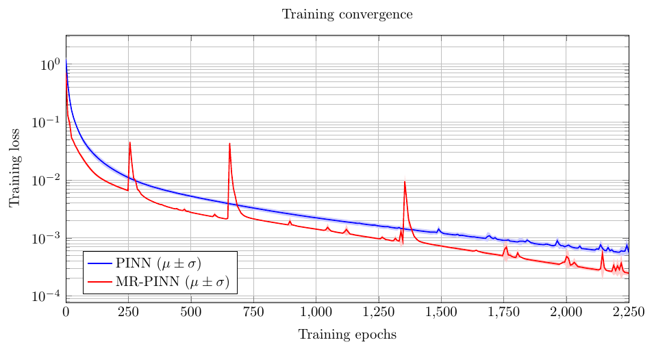

# MR-PINN: Multiresolution Physics-Informed Neural Networks

MR-PINN is a multiresolution training framework for Physics-Informed Neural Networks (PINNs) that accelerates convergence through adaptive resolution refinement and solution-guided upscaling. The method progressively trains PINNs on increasingly finer spatial resolutions, transferring learned solutions between levels via interpolation. This continuation strategy improves both training efficiency and predictive accuracy for PDE-governed distributed parameter systems. The repository includes implementations and examples for flow reactor case studies demonstrating the effectiveness of the proposed approach.

## More

- Details on the idea, background, and evaluation can be found in our paper: [Hopefully coming soon](www.sebastianknoll.net)

- The repository is also available on Zenodo, where it was accessible prior to publication.

# Examples

The repository is organized around two benchmark families, their generated outputs, and the scripts used to reproduce them. The most relevant folders are listed below.

## Folder structure

- `Benchmarks/B1/` contains the 1-species benchmark results.
    - `pinn/` stores the baseline PINN outputs, including `benchmark_results.csv` and `benchmark_summary.json` with aggregated metrics, `convergence_tikz_data.csv` for LaTeX plots, `statistical_report.txt` for the narrative summary, `statistical_tests.json` for the hypothesis-test results, and `loss_histories/` with per-run loss traces.
    - `interpolation_methods/` stores the multiresolution benchmark outputs for the interpolation comparison.
    - `interpolation_methods/nearest/`, `linear/`, and `spline/` each contain one interpolation variant with `benchmark_results.csv`, `benchmark_summary.json`, `loss_history_run*.npy` for the three example runs, and `method_report.txt` describing that method's outcome.
    - `comparison_summary.csv` and `comparison_summary.json` summarize the interpolation-method comparison across runs.
    - `stage_transition_reference.npz` contains reference data used for the multiresolution stage transitions.
- `Benchmarks/B1-3Species/` contains the 3-species benchmark results.
    - `benchmark_results.csv` and `benchmark_summary.json` provide the main quantitative results.
    - `convergence_tikz_data.csv` contains data prepared for LaTeX convergence plots.
    - `reaction_rate_comparison.csv` stores the reaction-rate comparison between methods.
    - `statistical_report.txt` and `statistical_tests.json` contain the statistical analysis.
    - `loss_histories/` stores the per-run loss histories for `pinn` and `rpinn`.
- `Data/` contains generated or benchmark-specific input data.
    - `rpinn_benchmark_3species/loss_histories/` stores the raw loss-history files used by the 3-species rPINN benchmark.
- `Images/` contains figures used in the documentation, including the project logo shown at the top of this README.
- `Latex/B1/` and `Latex/B1-3Species/` contain the LaTeX sources and generated auxiliary files for the benchmark figures.
    - The `.tex` files define the plots and tables.
    - The `.csv` files provide the data consumed by the LaTeX figures.
    - The `build/` folder in `Latex/B1/` contains LaTeX build artifacts such as `.aux` files.
- `Python/` contains the scripts used to generate the benchmark data, train the models, compare the methods, and prepare the TikZ figures.
    - `A0_generateFlowReactorPatterns.py`, `B0_generateFlowReactorPatterns3Species.py`, and `B1_generateFlowReactorPatterns3Species.py` generate the flow-reactor data used by the benchmarks.
    - `A1_PINN.py`, `A2_rPINN.py`, `A3_PINN_VS_rPINN.py`, and `A3_PINN_VS_rPINN_interpolation_compare.py` run the 1-species experiments and comparison studies.
    - `B2_PINN_3Species.py` and `B3_PINN_VS_rPINN_3Species.py` run the 3-species experiments and comparisons.
    - `make_tikz_convergence_4methods.py` and `make_tikz_figures_3species.py` convert benchmark results into LaTeX-ready figures.

## Reproducing the examples

The commands below reproduce the benchmark outputs and figures described above.

# Run the MR-PINN Benchmarks yourself

## Setup Python Environment

    python3 -m venv .venv
    source .venv/bin/activate
    pip install -r requirements.txt

## Run 1-Species Benchmarks

Same-network-epochs 1-species benchmark with `n = 30` runs and 2,200 total epochs:

    python3 Python/A3_PINN_VS_rPINN.py \
    --runs 30 \
    --output-dir Benchmarks/B1/pinn \
    --data-path Python/Data/flowReactorData.pkl \
    --pinn-epochs 2200 \
    --pinn-threshold 2e-5 \
    --pinn-patience 100 \
    --rpinn-epochs 300,400,500,1000 \
    --rpinn-thresholds 2e-5,2e-5,2e-5,2e-5 \
    --rpinn-patience 100

    python3 Python/A3_PINN_VS_rPINN_interpolation_compare.py \
    --runs 30 \
    --output-root Benchmarks/B1/interpolation_methods \
    --data-path Python/Data/flowReactorData.pkl \
    --pinn-epochs 2200 \
    --pinn-threshold 2e-5 \
    --pinn-patience 100 \
    --rpinn-epochs 300,400,500,1000 \
    --rpinn-thresholds 2e-5,2e-5,2e-5,2e-5 \
    --rpinn-patience 100 \
    --methods nearest,linear,spline

    cd Python
    python3 A3_PINN_VS_rPINN_random_init_compare.py \
    --runs 30 \
    --base-seed 0 \
    --data-path ./Data/flowReactorData.pkl \
    --output-root ./Data/rpinn_benchmark_1species_random_init_compare \
    --rpinn-schedule 4,20,70,100 \
    --rpinn-epochs 300,400,500,1000 \
    --rpinn-thresholds 2e-5,2e-5,2e-5,2e-5 \
    --rpinn-patience 20 \
    --device cpu

After the benchmark, generate the combined TikZ convergence figure with:

    python3 Python/make_tikz_convergence_4methods.py \
    --pinn-csv Benchmarks/B1/pinn/convergence_tikz_data.csv \
    --history-root Benchmarks/B1/interpolation_methods \
    --output-dir Latex/B1 \
    --pinn-epochs 2200 \
    --xmax 2200

Build the LaTeX plots in `Latex/B1`.

## Run 3-Species Benchmarks

Same-network-epochs 3-species benchmark with `n = 30` runs:

    python3 Python/B3_PINN_VS_rPINN_3Species.py \
    --runs 30 \
    --pinn-epochs 2250 \
    --output-dir Benchmarks/B1-3Species \
    --data-path Python/Data/flowReactorData_3species.pkl

After the benchmark, generate the combined TikZ convergence figure with:

    python3 Python/make_tikz_figures_3species.py \
    --input-dir Benchmarks/B1-3Species \
    --output-dir Latex/B1-3Species \
    --pinn-epochs 2250 \
    --rpinn-epochs 2250

Sample convergence figure from the 3-species example:

    
